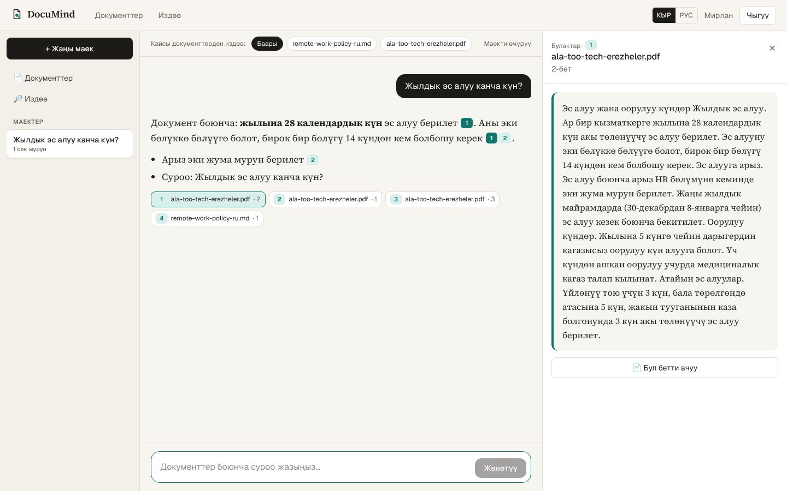

# DocuMind

**Chat with your documents.** Upload a PDF, Word file or text and ask questions. DocuMind retrieves the relevant passages, the LLM answers only from them, and every claim is cited with file and page; clicking a citation opens that page.



## Features

- **Documents:** PDF (page-aware), DOCX (incl. tables), TXT, MD; background ingestion with live status.
- **Hybrid retrieval:** pgvector semantic search + Postgres full-text search fused with Reciprocal Rank Fusion. Semantic search catches paraphrases and cross-language questions; lexical search catches exact names, numbers and rare terms.
- **Grounded, cited answers:** the model must cite `[n]` and say when the sources don't contain the answer.
- **Streaming** over Server-Sent Events, with a stop button.
- **Chat history** with follow-up context; chats can be scoped to selected documents.
- **Retrieval inspector** showing semantic and lexical ranks for any query.
- **Kyrgyz and Russian UI**; answers follow the question's language.
- **One-click demo** with bundled sample documents.

## Stack

FastAPI · SQLAlchemy 2 · Alembic · PostgreSQL 16 + pgvector · fastembed (local multilingual model) or Gemini embeddings · any OpenAI-compatible LLM (Groq by default) · Next.js 16 · React 19 · Tailwind 4 · pytest on real Postgres (14 tests).

## Run

```bash
cp .env.example .env    # set SECRET_KEY and LLM_API_KEY (free Groq key)
docker compose up --build
```

App: http://localhost:3200 · API docs: http://localhost:8200/docs

## Deploy

Render free plan (`render.yaml`) + Neon (pgvector) + Vercel. Production uses Gemini embeddings because the free 512 MB instance can't hold the local model.
