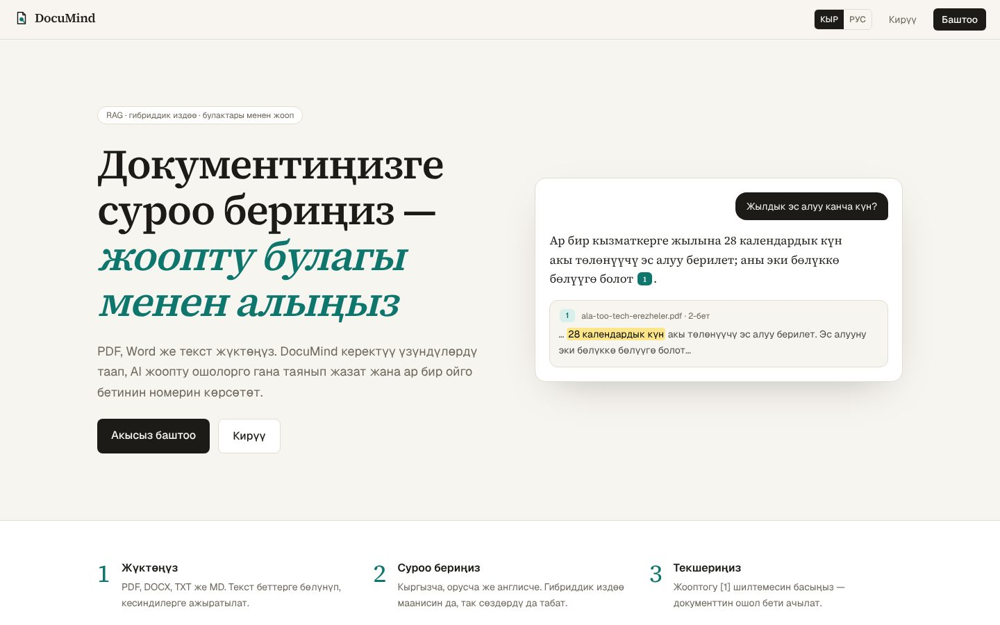
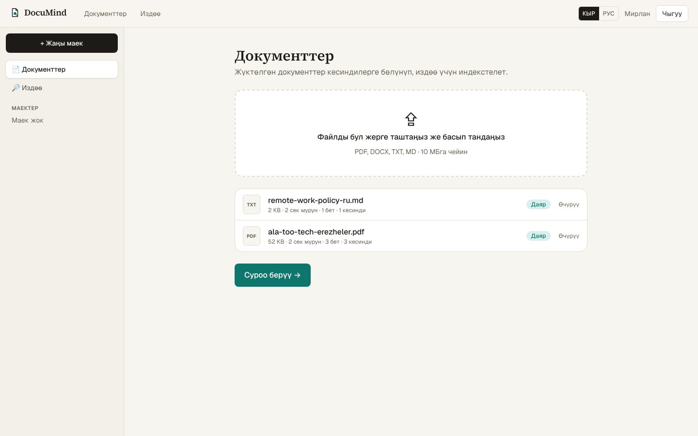
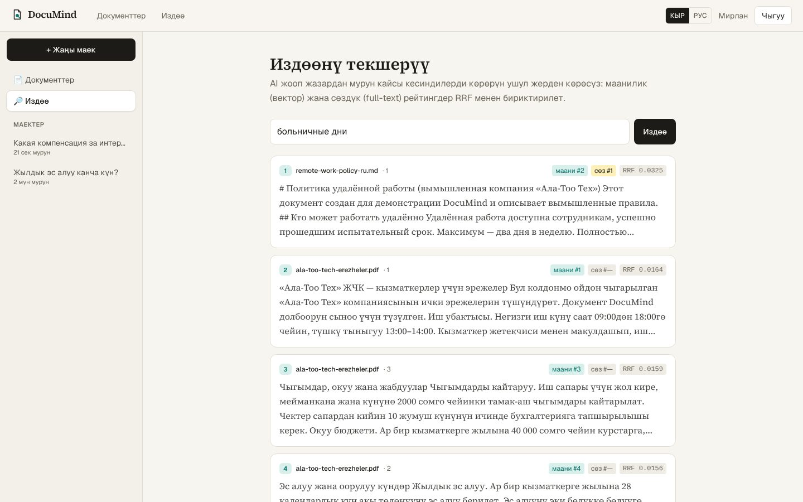
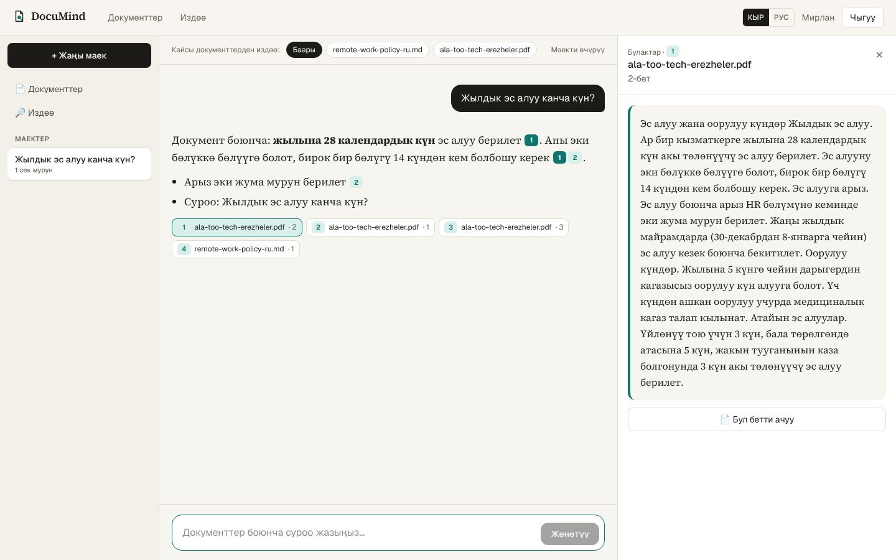
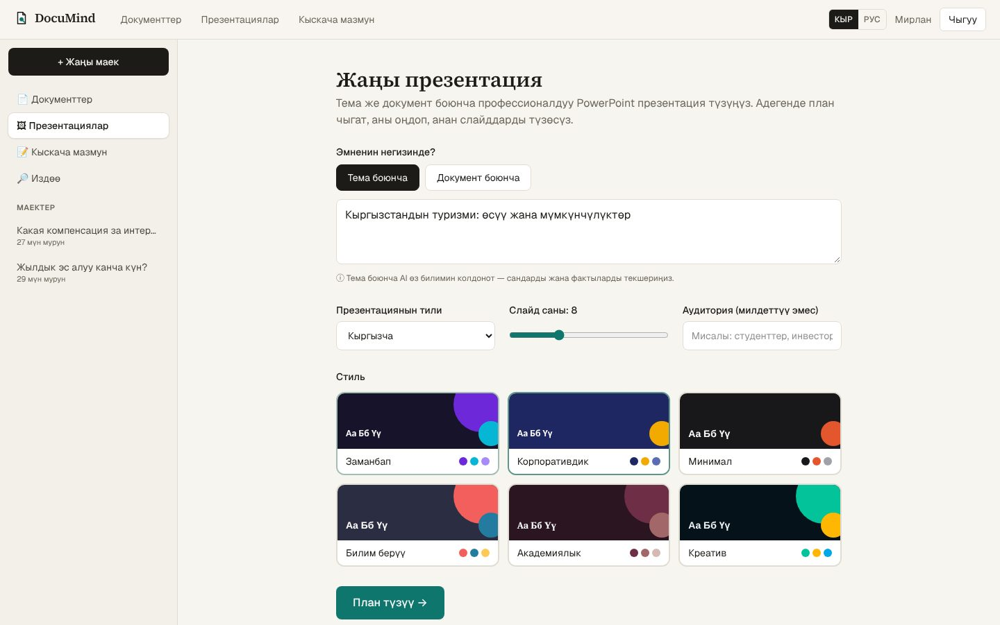
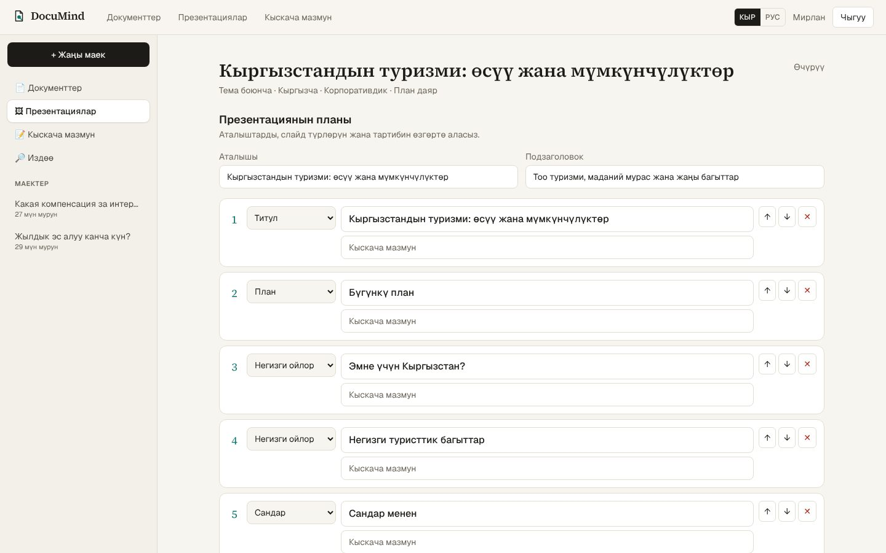
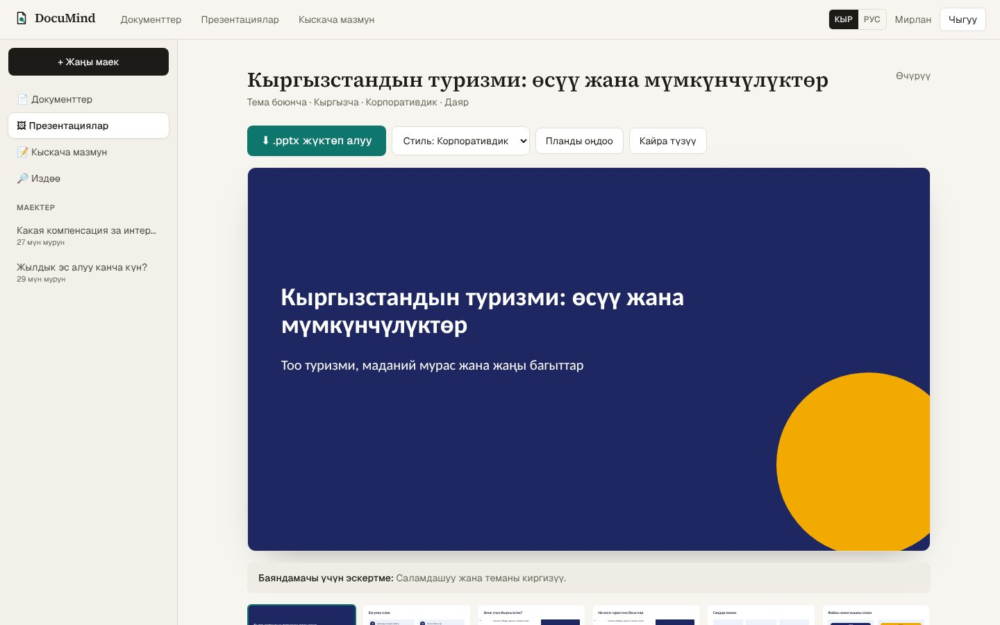
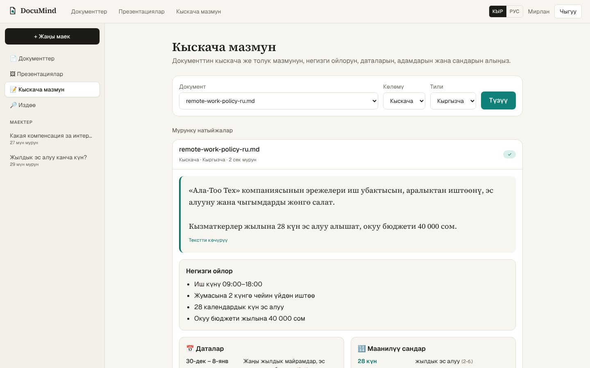

# DocuMind

**Документтериңиз менен иштеген AI студия.** Документ боюнча суроо бериңиз, кыскача мазмунун алыңыз же тема/документ боюнча профессионалдуу PowerPoint презентация түзүңүз.

PDF, Word же текст жүктөп, суроо бериңиз. DocuMind документтен керектүү үзүндүлөрдү табат, AI жоопту ошолорго гана таянып жазат жана ар бир ойго булагын (файл жана бет) көрсөтөт. Шилтемени бассаңыз, документтин ошол бети ачылат.

[English version](README.en.md)

![Маек: жооп сөз-сөзү менен агып чыгат, [1] шилтемеси булак үзүндүсүн ачат](docs/screenshots/chat.jpg)

## Мүмкүнчүлүктөр

### AI презентация түзүүчү
- **Тема боюнча же документ боюнча:** колдонуучу тема жазат (же документ тандайт), тилди (кыргызча, орусча, англисче), слайд санын (5–15), стилди жана аудиторияны белгилейт.
- **Эки кадам:** адегенде AI план түзөт, колдонуучу аталыштарды, слайд түрлөрүн жана тартибин оңдойт, анан AI ар бир слайддын мазмунун жана баяндамачы үчүн эскертмелерди жазат.
- **11 слайд түрү:** титул, план, негизги ойлор, салыштыруу, сандар, убакыт тилкеси, диаграмма, кадамдар, цитата, жыйынтык, рахмат.
- **6 стиль:** заманбап, корпоративдик, минимал, билим берүү, академиялык, креатив. Ар биринин өз түстөрү, шрифттери жана мотиви бар.
- **Чыныгы .pptx:** `python-pptx` менен түзүлөт. Бардык элементтер (текст, фигуралар, PowerPoint'тин өз диаграммалары) PowerPoint жана LibreOffice'те оңдолот. Слайд номерлери, баяндамачы эскертмелери бар. Сүрөт API'си керек эмес.
- **Алдын ала көрүү:** слайддар браузерде ошол эле стилде көрүнөт; стилди алмаштырсаңыз, дароо жаңыланат.

### Кыскача мазмун
- Кыскача же толук мазмун, негизги ойлор, даталар, адамдар/уюмдар, маанилүү сандар жана аткарыла турган иштер, беттери менен. Чоң документтер адегенде бөлүктөп кыскартылат (map-reduce), ошондо акысыз API'нин чегине батат.

### Документ менен маек

- **Документтер:** PDF (беттери менен), DOCX (таблицалар да), TXT, MD. Жүктөө фондо иштетилет, абалы экранда жаңыланып турат.
- **Гибриддик издөө:** pgvector'догу маанилик издөө жана Postgres full-text издөө, натыйжалары Reciprocal Rank Fusion менен бириктирилет. Маанилик издөө синонимдерди жана башка тилдеги суроону табат, сөздүк издөө так аттарды, сандарды жана сейрек терминдерди табат.
- **Булактары менен жооп:** AI булактарда жок нерсени ойлоп таппай, «билбейм» дейт. Ар бир ойго [1], [2] шилтемеси коюлат.
- **Streaming:** жооп Server-Sent Events аркылуу сөз-сөзү менен чыгат, «Токтотуу» баскычы бар.
- **Маек тарыхы:** кийинки суроолор мурунку контекстти эске алат. Маекти белгилүү документтер менен гана чектөөгө болот.
- **Издөөнү текшерүү:** AI кайсы үзүндүлөрдү көрөрүн жана алардын маанилик/сөздүк рейтингин көрсөткөн барак.
- **Эки тил:** интерфейс жана ката билдирүүлөрү кыргызча жана орусча. AI суроо берилген тилде жооп берет.
- **Демо үчүн бир басуу:** «Үлгү документтерди кошуу» баскычы ойдон чыгарылган компаниянын эрежелерин (PDF) жана саясатын (MD) кошот.

## Кантип иштейт

```
Жүктөө → текст (беттер менен) → кесиндилер (~1000 белги, 150 overlap, беттен ашпайт)
       → embedding → PostgreSQL (pgvector + tsvector)

Суроо → [вектор top-20] + [full-text top-20] → RRF → top-6 → LLM (булактар номерленген) → SSE
```

| Катмар | Технология |
|---|---|
| Backend | FastAPI, SQLAlchemy 2, Alembic |
| Издөө | PostgreSQL 16 + pgvector, `tsvector` (GIN индекси) |
| Embedding | fastembed (локалдык көп тилдүү модель, ачкычсыз) же Gemini `gemini-embedding-001` |
| AI жооп | OpenAI-шайкеш каалаган API (демейки Groq) |
| Frontend | Next.js 16 (App Router), React 19, Tailwind 4 |
| Презентация | python-pptx (PowerPoint'тин өз диаграммалары), 6 тема |
| Тесттер | pytest: чыныгы Postgres+pgvector'до 21 тест (парсинг, кесүү, издөө, SSE, презентация, кыскача мазмун, изоляция) |

## Иштетүү (Docker)

```bash
cp .env.example .env     # SECRET_KEY жана LLM_API_KEY (Groq, акысыз) жазыңыз
docker compose up --build
```

- Сайт: http://localhost:3200
- API документациясы: http://localhost:8200/docs

Embedding модели Docker image'ге куруу учурунда киргизилет, ошондуктан локалдык версия ачкычсыз иштейт. LLM_API_KEY жок болсо, издөө иштейт, бирок AI жооп жазбайт.

Тесттер: `cd backend && pytest -q` (pgvector орнотулган Postgres керек; CI'да `pgvector/pgvector:pg16` колдонулат).

## Жайгаштыруу

Render'дин акысыз планы (`render.yaml`) + Neon (pgvector акысыз) + Vercel (`API_URL`). Render'деги 512 МБ RAM локалдык модель үчүн аз, ошондуктан интернетте Gemini embedding API'си колдонулат (`EMBED_PROVIDER=gemini`, акысыз ачкыч: aistudio.google.com).

## Скриншоттор

| | |
|---|---|
|  |  |
|  |  |
|  |  |
|  |  |
